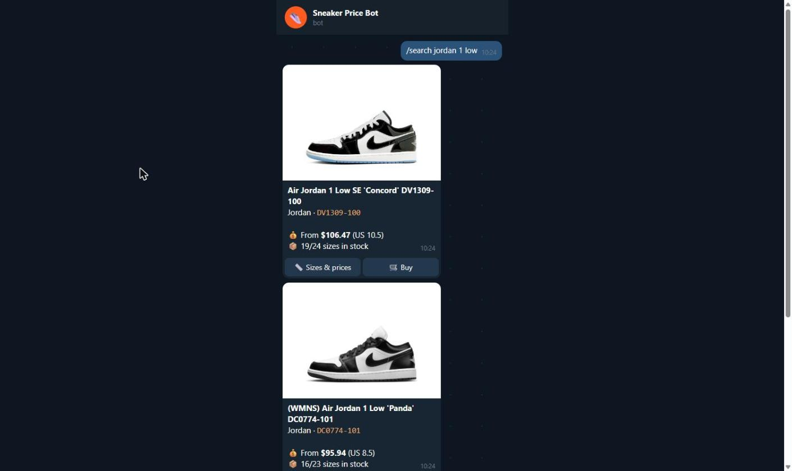
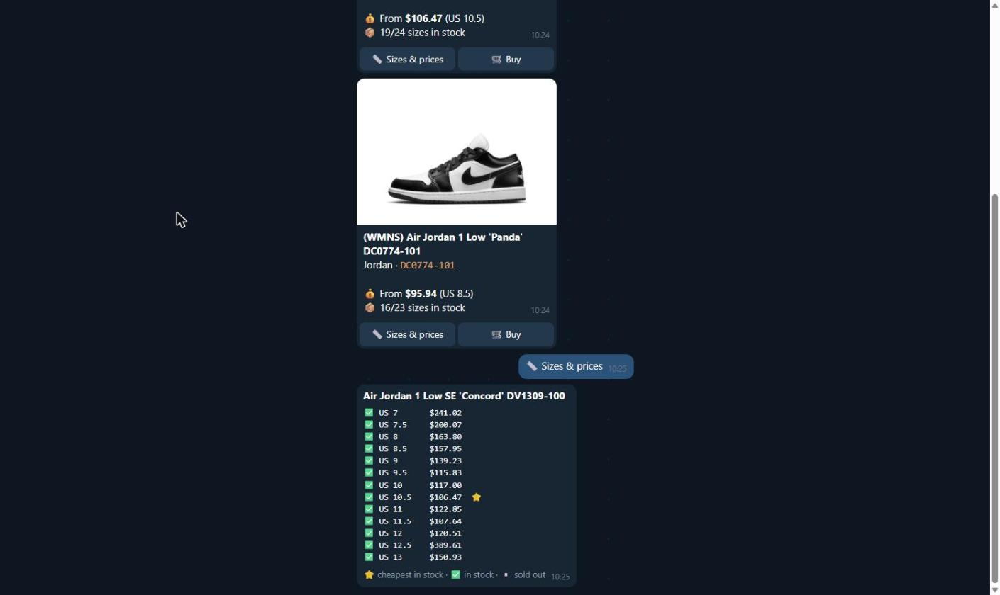

# 🤖 Sneaker Price Telegram Bot — photos, price of every size & price alerts

[](https://rapidapi.com/belchiorarkad-FqvHs2EDOtP/api/kickscrew-sneakers-data)
[](https://t.me/pintoflow)


> 🔑 **Data:** **[KicksCrew Sneakers Data API on RapidAPI](https://rapidapi.com/belchiorarkad-FqvHs2EDOtP/api/kickscrew-sneakers-data)**
>
> 💬 **Support on Telegram: [@pintoflow](https://t.me/pintoflow)** — fastest response for questions, bugs or custom bots.

A ready-to-deploy **Telegram sneaker bot** (Node.js + Telegraf). Type a sneaker name and get **photos, SKU, the “from” price and in-stock sizes**, tap **📏 Sizes & prices** for the price of every size, find the **cheapest pair in your size**, and set **price alerts**.

| Search results with photos | Price of every size |
|---|---|
|  |  |

*Screenshot rendered from real KicksCrew data ([docs/telegram-preview.html](docs/telegram-preview.html)).*

## Commands

| Command | What it does |
|---|---|
| `/search jordan 1 low` (or just type it) | Top 5 results with photo, SKU, from-price, sizes in stock, buttons |
| 📏 **Sizes & prices** button | Every size with price, ✅ in stock / ▫️ sold out, ⭐ cheapest |
| `/size 10 dunk low` | Cheapest in-stock pairs in **US 10** |
| `/alert <handle> 10 120` | Message me when US 10 is ≤ $120 (checked every 30 min) |
| `/alerts`, `/stop` | List / remove your alerts |

## Quick start

```bash
git clone https://github.com/BelNaruto/sneaker-price-telegram-bot
cd sneaker-price-telegram-bot
npm install
cp .env.example .env     # BOT_TOKEN from @BotFather, RAPIDAPI_KEY from RapidAPI
npm start
```

**Docker:** `docker build -t sneaker-bot . && docker run --env-file .env sneaker-bot`
Works on any VPS, Railway, Render, Fly.io or Google Cloud Run (with min instances = 1).

## How it works

| What | API endpoint |
|---|---|
| Search | `GET /search/v2?query=…&hitsPerPage=5&region=US&currency=USD` |
| Sizes & prices | `GET /product/description/byslugs?handle=…&country=US` |

Responses are cached for 5 minutes to save quota. Full API reference: [**kickscrew-sneakers-api**](https://github.com/BelNaruto/kickscrew-sneakers-api).

## Project structure

```
src/bot.js         → commands, inline buttons, alert scheduler
src/kickscrew.js   → tiny API client (search, details, size parsing, cache)
```

## Related projects

- [sneaker-price-tracker](https://github.com/BelNaruto/sneaker-price-tracker) — web app with price-by-size charts
- [sneaker-restock-monitor](https://github.com/BelNaruto/sneaker-restock-monitor) — Discord restock monitor
- [kickscrew-sneakers-api](https://github.com/BelNaruto/kickscrew-sneakers-api) — API docs & examples

---

💬 **Support on Telegram: [@pintoflow](https://t.me/pintoflow)** · 🔑 **API:** [https://rapidapi.com/belchiorarkad-FqvHs2EDOtP/api/kickscrew-sneakers-data](https://rapidapi.com/belchiorarkad-FqvHs2EDOtP/api/kickscrew-sneakers-data)

**Keywords:** sneaker telegram bot, telegram price bot, sneaker price checker, sneaker bot, jordan price, nike price alert, shoe price alert, telegraf bot example, kickscrew api.

MIT License · Not affiliated with KicksCrew or Telegram.
